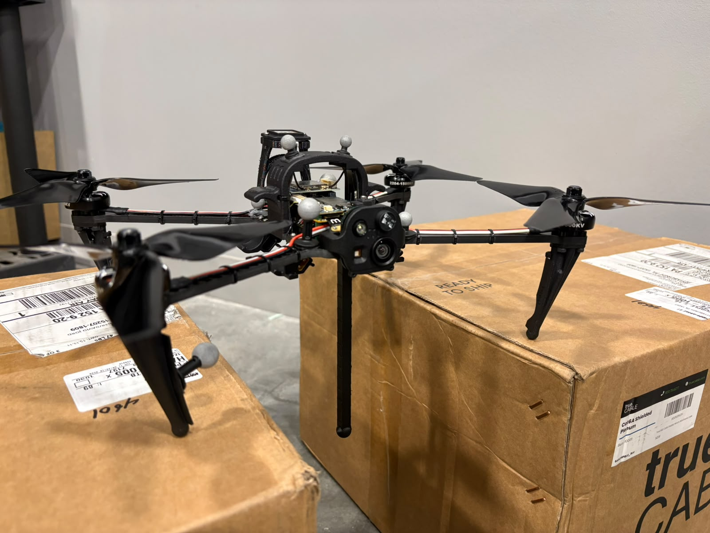
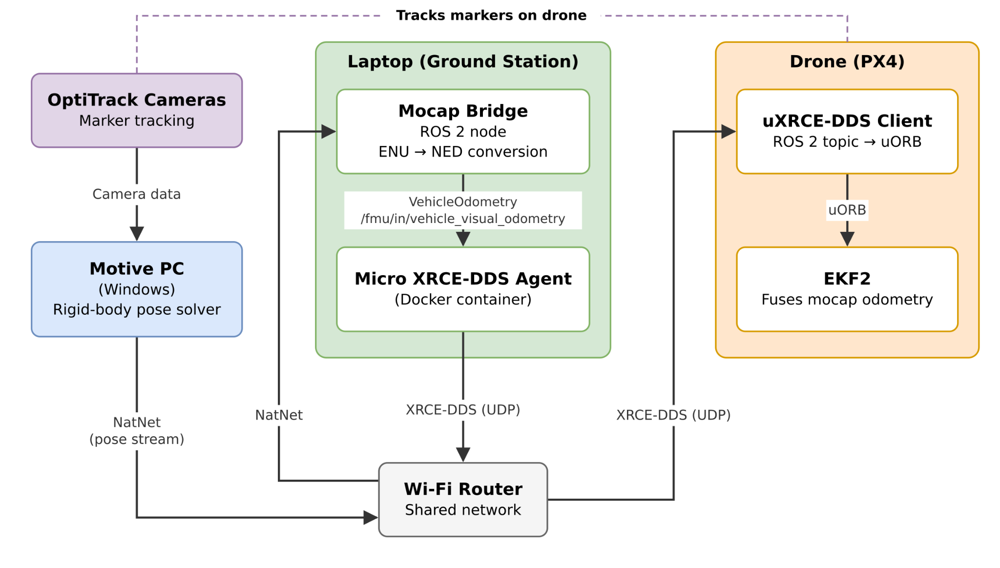
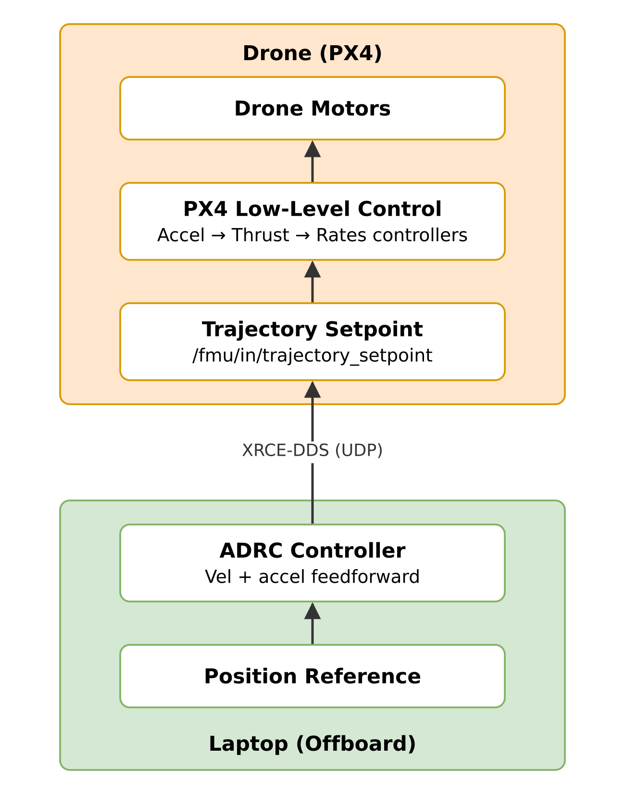

# CrazyMusician

**A wind-robust quadrotor pianist.** CrazyMusician is a ModalAI Starling 2 Max
quadrotor with a stylus mounted under its body that plays a melody on a
keyboard. For every note it has to find the right key, reach it by the note's
deadline, press it, and recover before the next one. It has to do this while
an external disturbance such as wind pushes it around.

  

### How it plays a note

- **Keyboard mapping.** Motion capture tracks the keyboard. Key positions come
  from its pose and the known key spacing, and a MIDI file timestamps each note.
- **Timing.** The melody isn't periodic, so each move is planned to its
  deadline. A late note shortens the time allowed for the next move.
- **Contact.** Pressing a key means pushing on it: the horizontal force stays
  below the drone's weight, and tilting adds vertical force. The drone must be
  stable again before the next note.
- **Disturbance rejection.** The position control is an ADRC (Active Disturbance
  Rejection Control) loop. An extended state observer (ESO) estimates the
  combined effect of wind, contact forces and model error, and the controller
  cancels it.

### Hardware and control

We fly in the motion-capture facility at the Robotics Innovation Center (RIC).
OptiTrack cameras track markers on the drone, and Motive solves the
rigid-body pose and streams it over NatNet. On the ground-station laptop, a
mocap bridge node converts the pose from ENU to NED and publishes it as
`/fmu/in/vehicle_visual_odometry`. The Micro XRCE-DDS Agent forwards it over
Wi-Fi to the drone, where PX4's EKF2 fuses it.

The ADRC controller also runs on the laptop, as a ROS 2 node (`acsi_music`).
It replaces PX4's position loop and sends a velocity setpoint with
acceleration feedforward on `/fmu/in/trajectory_setpoint`, over the same
XRCE-DDS link. PX4 runs the low-level velocity → acceleration → attitude →
rate loops down to the motors.

<table>
  <tr>
    <td align="center" width="62%"></td>
    <td align="center" width="38%"></td>
  </tr>
  <tr>
    <td align="center"><em>Hardware overview</em></td>
    <td align="center"><em>Control flow</em></td>
  </tr>
</table>

The hardware diagram shows the agent in a Docker container; with the setup
below it runs natively.

### What's in this repository

- **`acsi_music`:** the ROS 2 package with the ADRC controllers, flight-tested
  on the real drone.
- **Simulation:** PX4 v1.14.3 software-in-the-loop (SITL) in Gazebo Garden, with
  a Starling 2 Max model and airframe that match the drone's onboard firmware.
  The controller code is the same in simulation and on hardware; only the PX4
  host changes.
- **Tools:** wind injection for disturbance tests, flight recording, and
  analysis scripts.

Everything runs natively on Ubuntu (no Docker). ESO controller guide:
[docs/ESO_controller_quick_guide.pdf](docs/ESO_controller_quick_guide.pdf).

## Requirements

| Component | Version |
|---|---|
| OS | Ubuntu 22.04 |
| ROS 2 | Humble ([install guide](https://docs.ros.org/en/humble/Installation/Ubuntu-Install-Debs.html), `ros-humble-ros-base` is enough) |
| PX4 | v1.14.3 (upstream) + the Starling files in [config/px4](config/px4) |
| Gazebo | Garden (installed by PX4's setup script) |
| Micro XRCE-DDS Agent | v2.4.3 |

Don't install `ros-humble-ros-gz*`: it pulls Gazebo Fortress, which conflicts
with Garden.

## Setup (once)

### 1. Clone this repo

    git clone https://github.com/bavin-hub/CrazyMusician.git ~/CrazyMusician
    export CM=~/CrazyMusician          # used below; add it to ~/.bashrc

### 2. PX4 v1.14.3 with the Starling 2 Max model

Clone PX4 at the tested release:

    git clone --recursive -b v1.14.3 https://github.com/PX4/PX4-Autopilot.git ~/PX4-Autopilot
    export PX4=~/PX4-Autopilot         # add it to ~/.bashrc

Add the Starling 2 Max from [config/px4](config/px4):

| File in this repo | Copy to (inside `$PX4`) | What it is |
|---|---|---|
| `starling2max-*.zip` (unzips to `starling2max/`) | `Tools/simulation/gz/models/starling2max/` | Gazebo model (SDF, meshes) |
| `4007_gz_starling2max` | `ROMFS/px4fmu_common/init.d-posix/airframes/` | SITL airframe 4007 (tuned parameters) |
| `CMakeLists.txt` | `ROMFS/px4fmu_common/init.d-posix/airframes/` (replaces it) | v1.14.3's airframe list + `4007_gz_starling2max` |

    unzip $CM/config/px4/starling2max-*.zip -d $PX4/Tools/simulation/gz/models/ -x "*/.DS_Store"
    cp $CM/config/px4/4007_gz_starling2max $CM/config/px4/CMakeLists.txt \
       $PX4/ROMFS/px4fmu_common/init.d-posix/airframes/

`CMakeLists.txt` only adds the `4007_gz_starling2max` line to v1.14.3's file, so
use it with v1.14.3 only; on another version add that line by hand instead.

Install the toolchain and Gazebo Garden with PX4's script. v1.14.3's
`requirements.txt` has a matplotlib version spec that newer pip rejects, so
fix it first:

    sed -i 's/matplotlib>=3.0.\*/matplotlib>=3.0.0/' $PX4/Tools/setup/requirements.txt
    bash $PX4/Tools/setup/ubuntu.sh --no-nuttx
    python3 -m pip install --user "empy==3.3.4"     # PX4 v1.14 and ROS 2 Humble both break with empy 4.x
    sudo apt install ffmpeg x11-utils wmctrl        # screen recording (tools/recorder.py)

Log out and back in (the script changes groups and `PATH`), then build once:

    cd $PX4 && make px4_sitl

### 3. Micro XRCE-DDS Agent (bridges PX4 to ROS 2)

    git clone --depth 1 -b v2.4.3 https://github.com/eProsima/Micro-XRCE-DDS-Agent.git ~/Micro-XRCE-DDS-Agent
    cd ~/Micro-XRCE-DDS-Agent && mkdir build && cd build
    cmake .. -DCMAKE_BUILD_TYPE=Release && make -j"$(nproc)"
    sudo make install && sudo ldconfig /usr/local/lib/

### 4. ROS 2 workspace: px4_msgs, px4_ros_com, acsi_music

`px4_msgs` must match the firmware's message definitions (PX4 v1.14).
`acsi_music` is symlinked from this repo, so edits here are what gets built.

    sudo apt install python3-colcon-common-extensions python3-numpy python3-yaml
    mkdir -p ~/cm_ws/src && cd ~/cm_ws/src
    git clone -b release/1.14  https://github.com/PX4/px4_msgs.git
    git clone -b release/v1.14 https://github.com/PX4/px4_ros_com.git
    ln -s $CM/depl/acsi_music acsi_music

    cd ~/cm_ws
    source /opt/ros/humble/setup.bash
    colcon build --symlink-install
    echo "source ~/cm_ws/install/setup.bash" >> ~/.bashrc

The first build takes a few minutes (px4_msgs). Later, rebuild only our package:
`colcon build --symlink-install --packages-select acsi_music`.

## Run a simulated flight

Three terminals:

    # 1. DDS agent
    MicroXRCEAgent udp4 -p 8888

    # 2. PX4 SITL + Gazebo (Starling 2 Max, airframe 4007)
    cd $PX4
    make px4_sitl gz_starling2max

    # 3. Controller
    ros2 topic list | grep /fmu/                      # PX4 topics should be listed
    ros2 run acsi_music adrc_vel_deploy_user --config $CM/depl/acsi_music/config/adrc_vel_deploy.yaml

Terminal 2 ends at the PX4 shell (`pxh>`), where you can type PX4 commands
(`commander takeoff`, `commander mode offboard`, `commander land`,
`commander check`). The `_auto` executables arm and switch to Offboard
themselves; the `_user` ones wait for you to do it. See
[depl/acsi_music/README.md](depl/acsi_music/README.md) for every executable,
its YAML options and `enable_test` (dry run, publishes nothing to PX4).

**Namespace.** The YAML's `namespace: ""` matches SITL's default topics
(`/fmu/...`). To simulate a namespaced drone (e.g. `/drone_dm/fmu/...`), start
PX4 with `PX4_UXRCE_DDS_NS=drone_dm` and set `namespace: "drone_dm"` in the YAML.

### Record a flight

    mkdir -p $CM/logs/bags && cd $CM/logs/bags
    ros2 bag record -o adrc_$(date +%Y%m%d_%H%M%S) \
        /fmu/out/vehicle_odometry /fmu/out/vehicle_status \
        /fmu/in/trajectory_setpoint /fmu/in/offboard_control_mode

### Wind panel (interactive wind)

The wind tools drive the `WindEffects` plugin of a Gazebo world named
`crazymusician` (`WORLD` in [tools/wind.py](tools/wind.py)). PX4 v1.14.3's
`default` world doesn't have it, so the panel needs that world added to
`$PX4/Tools/simulation/gz/worlds/` and PX4 started with
`PX4_GZ_WORLD=crazymusician`. With that simulation running:

    python3 $CM/tools/wind_panel.py       # then open http://localhost:8765

Sliders set wind speed and direction; arrows in Gazebo show the wind. The
panel can also record the Gazebo window to `videos/`. Keep the browser beside
Gazebo, not over it, while recording.

### Chase camera

    gz service -s /gui/follow --reqtype gz.msgs.StringMsg --reptype gz.msgs.Boolean \
        --timeout 2000 --req 'data: "starling2max_0"'
    gz service -s /gui/follow/offset --reqtype gz.msgs.Vector3d --reptype gz.msgs.Boolean \
        --timeout 2000 --req 'x: -1.2, y: -0.6, z: 0.6'

Release it with the first command and `data: ""`.

## Real drone

On the companion computer, repeat setup steps 3–4 (agent only if nothing else
already runs one). Check that `ros2 topic echo --once /<ns>/fmu/out/vehicle_status`
prints fields (px4_msgs matches the firmware), set `namespace` in the YAML to
the drone's namespace, then run the controller as above. The real drone's PX4 parameter dump
(`D0012_Starling_2_Max.params`) is inside the model zip.

## Analyze

Scripts for `logs/adrc_*.csv` logs (written by the earlier offboard controller):

    python3 analysis/plot_adrc.py                         # newest log -> PNG
    python3 analysis/plot_hover.py [LOG.csv]              # hover metrics
    python3 analysis/compare_wind.py ADRC.csv PX4.csv     # error table by phase
    python3 analysis/compare_plots.py ADRC.csv PX4.csv [PANEL.csv]

## Layout

    depl/acsi_music/         ROS 2 controller package (flight-tested)
    analysis/                plotting and comparison scripts
    tools/                   wind model control + arrows, wind panel, recorder
    config/px4/              Starling 2 Max model zip, airframe 4007, airframe CMakeLists.txt (for PX4 v1.14.3)
    docs/                    ESO controller guide, README images (docs/images/)
    logs/, videos/           outputs (not in Git; share separately)

## Troubleshooting

- **No `/fmu/` topics in ROS 2:** the agent must be running, and PX4's output should
  show `uxrce_dds_client` connected. Check `ROS_DOMAIN_ID` is the same everywhere.
- **`ros2 topic echo` fails to decode:** `px4_msgs` is not on `release/1.14`.
- **PX4 build errors mentioning `em` / empy:** `python3 -m pip install --user "empy==3.3.4"`.
- **PX4 refuses to arm:** run `commander check` in the `pxh>` shell.
- **Stale simulation:** `pkill -f "bin/px4"; pkill -f "gz sim"` before restarting.

Notes: the simulation uses GPS-based state estimation, which adds ~5 cm of slow
position wander; the wind force in Gazebo is about 1.3x the nominal
k = 0.3 1/s drag model.
